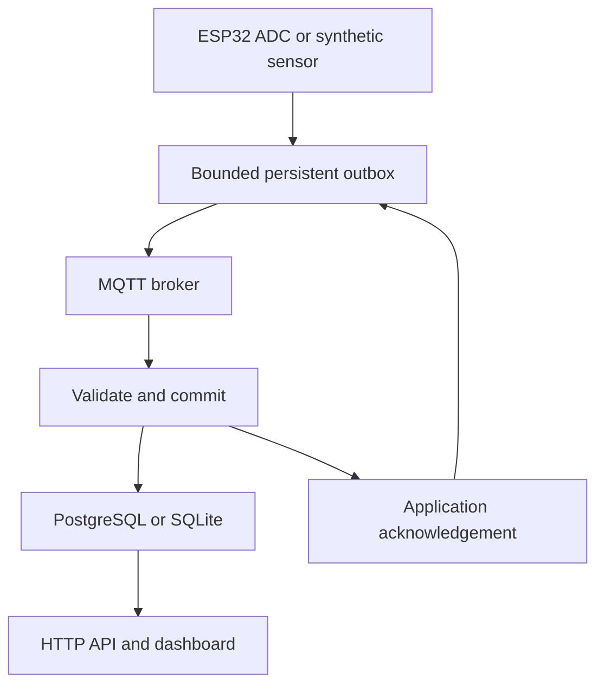

# Architecture and protocol



## Schema v0.1

MQTT input: `devices/<device_id>/telemetry`. ACK: `devices/<device_id>/ack`, not retained.

```json
{"device_id":"demo-01","boot_id":"session-1","seq":0,"uptime_ms":2000,"metric":"temperature_c","value":24.5,"source":"simulated","firmware":"sim-0.1.0"}
```

All eight fields are required, with no additional fields. IDs/firmware use 1–40 ASCII letters, digits, underscores or hyphens. Sequence and uptime are nonnegative signed-64-bit-range integers, excluding booleans. Values must be finite; temperature range -100..200 °C; ADC range 0..4095. Source is `hardware` or `simulated`. Body bound: 1024 bytes. Source/identity declarations are not authenticated.

```json
{"device_id":"demo-01","boot_id":"session-1","seq":0,"status":"stored"}
```

An identical replay receives `duplicate`. Changed content under an existing identity is rejected and gets no success ACK. The stored timestamp is unchanged by duplicates. The service acknowledges only after transaction context exit commits successfully. A lost ACK causes retry; the primary key prevents a second row. This is at-least-once attempted delivery with idempotent storage, not a universal exactly-once guarantee.

## Buffer behavior

Simulator: SQLite transaction per queued sample, persistent random boot ID inside each record, monotonic process uptime, FIFO, 32 entries. New samples drop when full; the persistent `counters` table records drops. `--samples N` stops sampling at N and waits to drain; during an outage it keeps running until interrupted. Keep one simulator process per outbox/device.

ESP32: one boot counter written to NVS at startup, sequence in RAM, one LittleFS JSON file per committed record. Write temporary file, flush, close, rename; incomplete temporary file is discarded on restart. Old queued records retain their original boot ID. Capacity 32; drop-new count is RAM-only and printed to Serial. The pending filesystem write can be lost during a power cut, and filesystem/NVS durability needs physical validation. Never erase NVS while keeping old queue files or reuse a device ID for another board. IDs are configuration, not hardware identity.

The firmware retries the oldest record every five seconds. An ACK must match its device, boot ID, sequence and accepted status before file removal. QoS 0 firmware publishing is intentional: application ACK plus retained queue covers retry. Backend/simulator use QoS 1. MQTT receipt/PUBACK alone does not prove database commit. Firmware Wi-Fi/MQTT connection attempts may block for bounded network calls; this is not a hard real-time system.

## Freshness and history

Server UTC receipt timestamps are authoritative for this UI. `recent` means a new unique reading was received within 15 seconds; otherwise `stale`. Backlog delivery can make a disconnected node appear recent, so the UI describes reading freshness instead of asserting online health. Device `uptime_ms` wraps after roughly 49.7 days in the firmware; sequence/boot ID, not uptime, is the deduplication key. Chart spacing is record order, not elapsed time. Compare only a single metric in the chart.

## Deployment boundary

The stdlib HTTP server is a local reference service; no production worker limits, user auth, TLS or rate limiting. Compose broker is anonymous inside its Docker network and loopback-published on the host. Its broker queue is not durable; device outboxes supply retry. Never expose these services publicly as configured. Before LAN deployment, add broker credentials, per-device publish/subscribe ACLs, TLS, authenticated API/reverse proxy, backup/retention and load tests. OTA/security/observability are future work.

## Primary references

- [Paho Python documentation](https://eclipse.dev/paho/clients/python/docs/) — callback API v2 and MQTT client lifecycle.
- [ESP-MQTT](https://docs.espressif.com/projects/esp-mqtt/en/latest/esp32/) — transport/retransmission background; firmware here uses PubSubClient, not ESP-MQTT.
- [PubSubClient API](https://pubsubclient.knolleary.net/api) — callback and buffer behavior.
- [Psycopg transactions](https://www.psycopg.org/psycopg3/docs/basic/transactions.html) — commit/rollback context semantics.
- [ESP-IDF OTA](https://docs.espressif.com/projects/esp-idf/en/stable/esp32/api-reference/system/ota.html) — proposed future rollback design, not implemented here.
